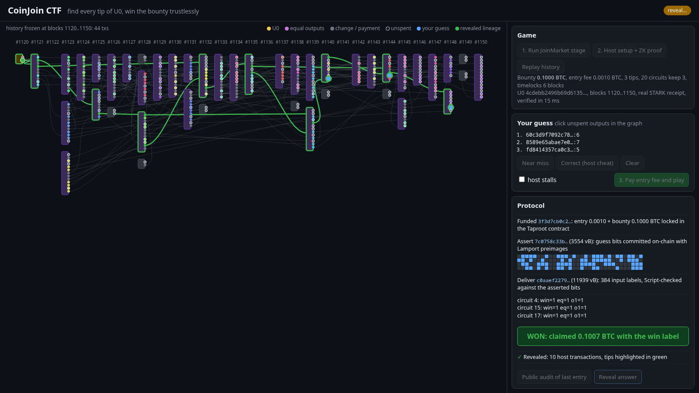
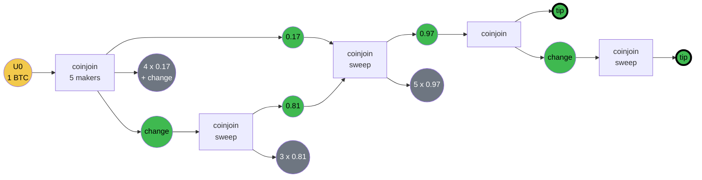
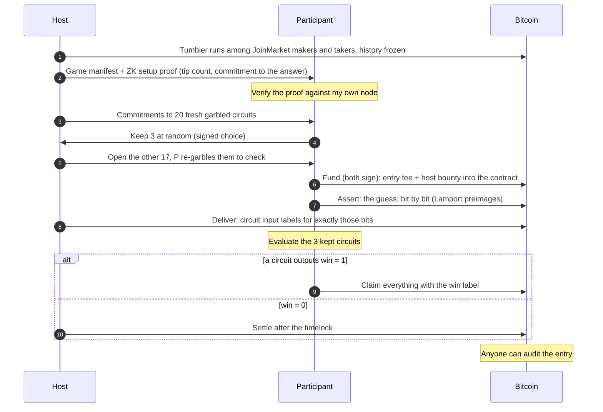
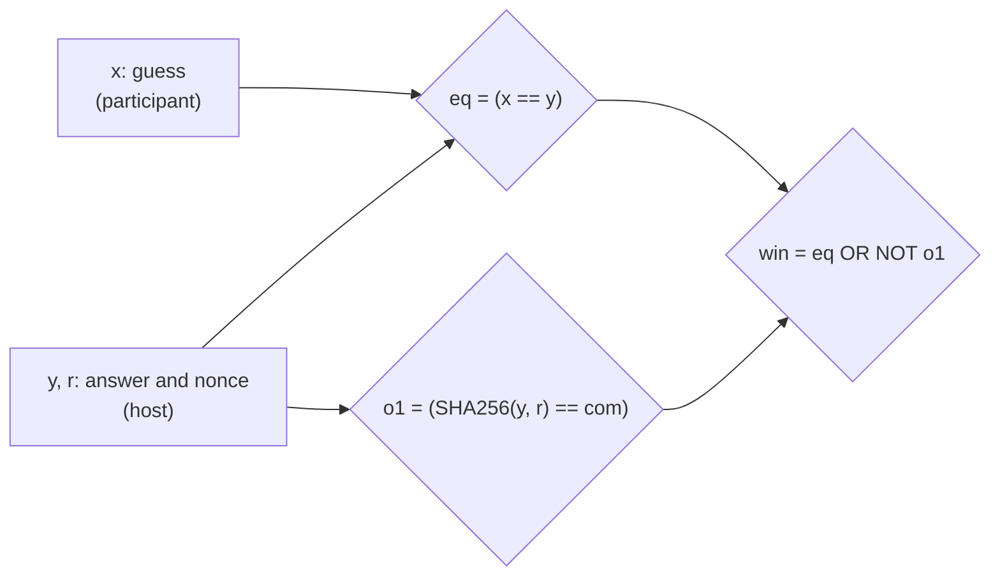
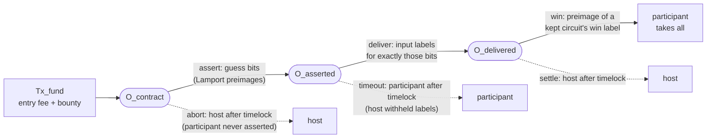
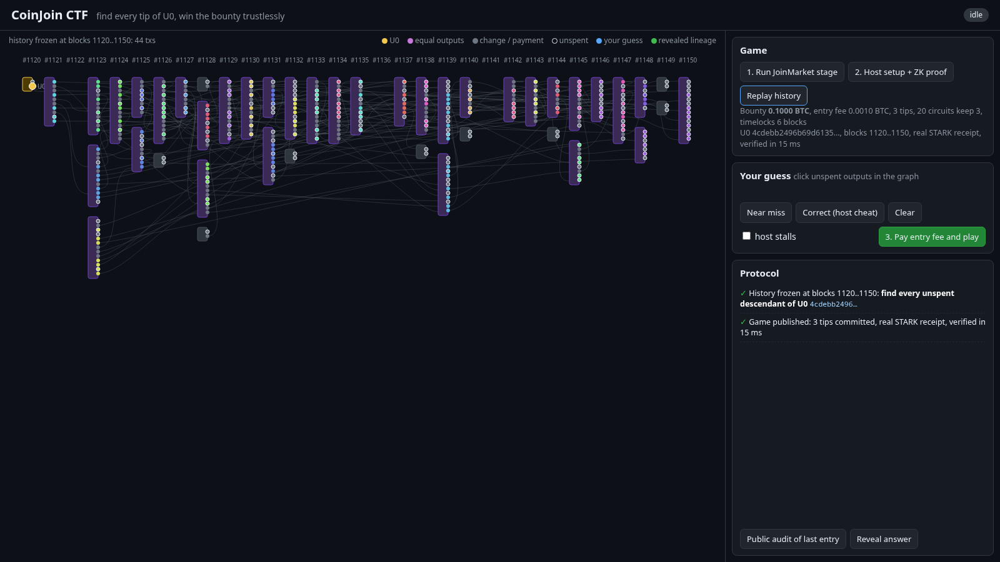
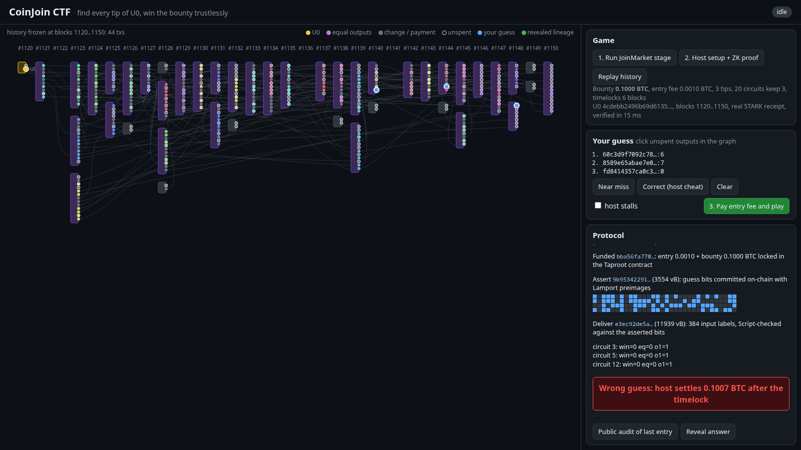
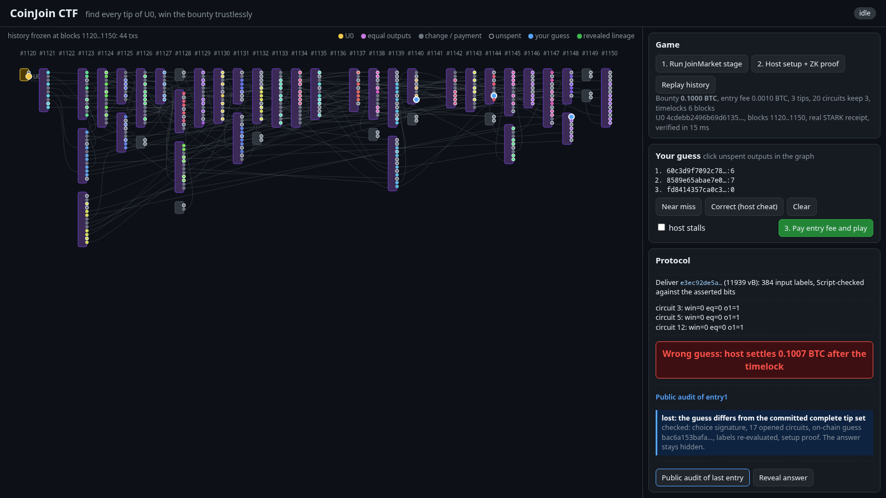
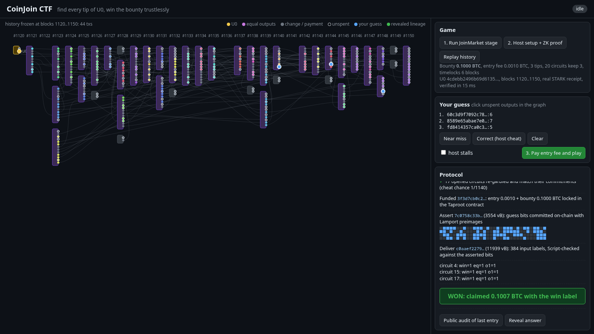

# coinjoinctf

**Can you undo a CoinJoin? Prove it and take the sats.**

A host sends one coin (U0) through a realistic JoinMarket history and locks a bounty behind a
Bitcoin contract. Name **every** coin that U0 ended up in and you claim the bounty yourself: no
judge, no host cooperation. Guess wrong and you lose your entry fee, but anyone can verify that your
guess was wrong and that a correct answer existed, without learning the answer.



Hackathon proof of concept on regtest: simulated JoinMarket makers and takers, a pure-Python
garbled circuit, a Taproot contract, and a RISC Zero zero-knowledge proof.

## The idea

Chain analysis claims are cheap. This turns them into a bet with real money and a referee that
nobody has to trust. Four questions, four mechanisms:

| A participant asks | Answer | Mechanism |
|---|---|---|
| Is there really an answer, and is it complete? | Proven before you pay | **ZK setup proof** (RISC Zero) |
| Who decides whether my guess is right? | A circuit, not the host | **Garbled circuit** with cut-and-choose |
| Who pays out? | Bitcoin Script, to the winner alone | **Taproot contract**, hashlocked on the circuit's "win" output |
| I lost. Was it fair? | Anyone can check, the answer stays hidden | **Public audit** from the chain and a transcript |

## The challenge

The host withdraws U0 from an "exchange" and runs a JoinMarket tumbler among simulated makers
(offers, real timelocked fidelity bonds, bond-weighted selection) and random takers, block by block
with random delays. Then the history is frozen.

The answer is the set of **tips**: start at U0, follow every transaction that spends one of the
host's coins, keep the outputs that go back to the host's wallet, and stop at the coins still
unspent at the end. Equal-amount outputs, change and peel chains all count. Outputs to makers or
payees end their branch.



This is the view *after* the reveal. To an analyst every output looks gray: within a coinjoin the
host's output has the same amount as the makers' outputs. A guess is encoded as
`SHA256("\n".join(sorted("txid:vout")))[:16]` (128 bits), so order does not matter and a subset or
a superset is simply wrong.

## How a game is played



## The three mechanisms

### 1. Setup proof: the committed answer is real and complete

The host commits to the answer `y` with `com = SHA256(y || r)` and proves in the RISC Zero zkVM,
without revealing its wallet or the tips, that:

- the private raw blocks form a hash chain and every transaction matches its merkle root;
- the wallet with commitment `SHA256(seed)` (P2WPKH keys `SHA256("coinjoinctf/wallet/v1" || seed || i)`
  for `i < key_limit`) owns U0, which is created in the range;
- the tips are exactly the owned lineage outputs unspent at the end block, and `com` hashes them.

The public journal holds the wallet commitment, `key_limit`, U0, the first and last block hashes,
the block count, the tip count and `com`. Every participant must verify the receipt before entering
and checks the block hashes against **its own node**. Proving takes minutes; verifying takes
milliseconds.

### 2. Garbled circuit: the outcome is computed, not claimed

The circuit takes the participant's guess `x` and the host's secret inputs `y` and `r`:



| Host | Guess | `win` | Result |
|---|---|---|---|
| honest | right | 1 | participant claims the bounty |
| honest | wrong | 0 (and `o1 = 1`) | host settles; the audit proves the guess wrong |
| uses anything but the committed answer | any | 1 (`o1 = 0`) | participant claims the bounty |

Cheating on the inputs therefore hands the participant a win. Cheating on the circuit itself is
what cut-and-choose catches: per entry the host garbles 20 fresh instances (half-gates, free-XOR,
22,222 AND gates, 0.7 MB each) and commits to them, the participant keeps 3 at random and signs
the choice, and the host opens the other 17 for re-garbling. Because the circuits are fresh and the
guess is committed on-chain before any label is released, nobody can test a guess offline.

### 3. Taproot contract: Bitcoin Script pays the winner

Three outputs, a NUMS internal key (no key-path spend), and every transition presigned by the party
that would lose from a redirect:



The `deliver` script checks, bit by bit, that each label matches the bit the participant revealed
on-chain, so the host cannot feed a different guess. The participant evaluates the 3 kept circuits
with those labels and the host's own input labels. If any outputs `win = 1`, that output label is
the preimage for the `win` leaf.

### Public audit: losing is provable, the answer stays hidden

After an entry the host publishes a transcript: circuit commitments, the signed choice, the opened
seeds, the kept circuits' tables, the host's input labels, the Lamport hashes and the txids. Anyone
can re-check the choice signature, re-garble the opened circuits, read the guess from the assert
witness and the labels from the deliver witness, re-evaluate the kept circuits, and re-verify the
setup proof. `win = 0, o1 = 1` on every kept circuit proves that the guess differs from a committed,
complete tip set. The answer stays hidden: kept seeds are never revealed, and each host input
label hides its bit.

## Demo walkthrough

The web UI shows the transaction graph on the left (one column per block, equal-amount outputs
colored per coinjoin, unspent outputs ringed, U0 in gold) and the protocol on the right.

**1. The frozen history.** About 30 blocks of JoinMarket activity: makers with fidelity bonds,
random takers, and the host's tumbler hidden among them. The game is published with a real STARK
receipt that the page verifies in milliseconds.



**2. A near miss loses.** The guess swaps one tip for an equal-valued sibling output of the same
coinjoin, the mistake a careless analyst makes. The participant verifies the setup proof, checks 17
opened circuits, funds, asserts the 128 guess bits on-chain (the bit grid) and gets the labels. All 3
kept circuits say `win=0 eq=0 o1=1`, and the host settles after the timelock.



**3. Anyone audits it.** From the chain and the transcript alone: the guess differs from the
committed complete tip set. The answer is not revealed.



**4. The right answer wins.** All 3 kept circuits output `win=1`, and the participant claims
entry fee plus bounty with the win label, unilaterally.



**5. Reveal (optional).** After the game, the host can disclose its transactions: the lineage
from U0 to the tips is drawn in green.

## Presenting it

After the [quick start](#quick-start), prepare the game beforehand (the real proof took 7 min for
a 31-block game on a 16-core CPU), then run the rest live: each entry takes about 3 s.

```sh
docker compose up -d                                   # keep it running: the chain lives in tmpfs
uv run coinjoinctf --state tmp/talk stage --makers 8 --takers 3
uv run coinjoinctf --state tmp/talk setup              # real STARK proof
uv run --with playwright python demo/record.py --from tmp/talk --real --out tmp/talk-video  # backup video
uv run coinjoinctf --state tmp/talk serve              # live: http://127.0.0.1:8000
```

On the page: **Replay history** animates the graph block by block. Then **Near miss**, **Pay entry
fee and play**, **Public audit of last entry**, **Correct**, **Pay entry fee and play** again, and
**Reveal answer**. The recorder works on a copy of the state, so the live game starts clean. The
backup is `tmp/talk-video/demo.mp4` (and `.webm`) plus one screenshot per phase.

## Trust model and known limits

- **Cut-and-choose soundness.** A host that garbles dishonestly survives the opening with
  probability `1 / C(20, 3) = 1/1140` per entry. A malformed kept instance shows up as an evaluation
  error, which the audit reports as host misbehavior.
- **Stalling does not help the host.** If it never delivers labels, `timeout` pays the participant
  the whole contract (entry fee and bounty).
- **The host can always win its own bounty.** It knows the answer and funds the game, so that only
  costs itself.
- **Serial entries.** A winning assert publishes the answer bits on-chain, so the game ends at the
  first win. Timing races (a late assert against the host's `abort` leaf) are not addressed;
  participants should assert promptly.
- **Ownership is part of the definition.** Only outputs of the committed wallet (`key_limit` keys,
  padded to a multiple of 16 to hide the exact address count) are tips; payments to anyone else end
  that branch. The proof covers the frozen block range only.
- **Out of band leaks are out of scope.** Anyone who learns the host's transactions directly (a
  colluding maker set, the host itself) can win.
- **Dev mode** (`--dev`) uses fake RISC Zero receipts for fast iteration; without `--dev`,
  participants reject them.
- **Demo shape.** Regtest only. Host and participant live in one process but only exchange protocol
  messages.

Measured on a 16-core CPU (no GPU):

| | |
|---|---|
| Setup proof, 31 blocks, 44 txs | 3.7M cycles, 7 min, 9.6 GB RAM |
| Setup proof, 36 blocks, 61 txs | 6.55M cycles, about 20 min (machine under load), 224 KB succinct receipt |
| Verifying the receipt | 15 to 40 ms |
| One entry on regtest | about 3 s: garble 20, check 17, fund, assert, deliver, evaluate, settle or claim |
| Assert / deliver tx | 3.6 kvB / 11.9 kvB (514 witness items; BIP342 allows 1000, so at most 6 kept instances) |

## Quick start

Requirements: Docker, [uv](https://docs.astral.sh/uv/), and the RISC Zero toolchain
([rzup](https://dev.risczero.com/api/zkvm/install)) to build the prover.

```sh
docker compose up -d                       # regtest node (tmpfs: a restart wipes the chain)
uv sync --extra dev
(cd zk && cargo build --release)           # zk/target/release/ctf-zk, a few minutes cold
uv run coinjoinctf --dev demo --fresh --makers 8 --takers 3
```

`demo` narrates the whole story in about 20 s: the JoinMarket stage, the setup proof, a near miss
(one tip swapped for an equal-valued sibling) that loses and is publicly audited, a correct guess
that wins and claims, and the optional reveal.

Step by step (state lives in `tmp/game`, host secrets in mode 0600 files):

```sh
uv run coinjoinctf stage --makers 12 --takers 4   # run the ecosystem, freeze the history
uv run coinjoinctf setup                          # host: commit + real setup proof (minutes)
uv run coinjoinctf play TXID:VOUT [TXID:VOUT ...] # participant: verify the proof, enter, play
uv run coinjoinctf audit entry1                   # anyone: audit a finished entry
uv run coinjoinctf reveal                         # host: optional disclosure after the game
```

`play --demo-guess correct|near_miss` lets the host pick the guess, and `--stall` simulates a host
that withholds labels.

`uv run coinjoinctf --dev serve` starts the web UI on a fresh dev-mode game (buttons 1 and 2 run the
stage and the proof live). Screencast of a fresh dev-mode game:
`uv run --with playwright python -m playwright install chromium` (once), then
`uv run --with playwright python demo/record.py`. Terminal recording:
`asciinema rec -c "uv run coinjoinctf --dev demo --fresh --makers 8 --takers 3 --pause 1.5" tmp/demo.cast`.

## Layout

| Path | What |
|---|---|
| `src/coinjoinctf/circuit.py` | Game circuit with a SHA-256 gadget and constant folding |
| `src/coinjoinctf/garble.py` | Half-gates garbler/evaluator, commitments, opened-instance checks |
| `src/coinjoinctf/contract.py` | Taproot leaves, Lamport commitments, witnesses |
| `src/coinjoinctf/game.py` | Host and participant roles, one entry end to end |
| `src/coinjoinctf/stage.py` | JoinMarket ecosystem, fidelity bonds, tumbler, reference tip oracle |
| `src/coinjoinctf/zk.py`, `zk/` | RISC Zero guest (the setup statement) and `ctf-zk prove/verify` |
| `src/coinjoinctf/audit.py` | Entry transcript and third-party audit |
| `src/coinjoinctf/session.py`, `cli.py`, `web.py`, `static/` | Orchestration, CLI, web demo |
| `demo/record.py` | Playwright screencast of the web demo |

## Tests

```sh
uv run pytest
```

Regtest tests skip without the node, and ZK tests skip without the built prover. ZK tests run the
guest for real in dev mode (only the seal is fake) and compare its journal with the Python oracle
`stage.owned_tips`.

## Authors and license

Adam Gibson (waxwing) and m0wer. Released under the [MIT License](LICENSE).
